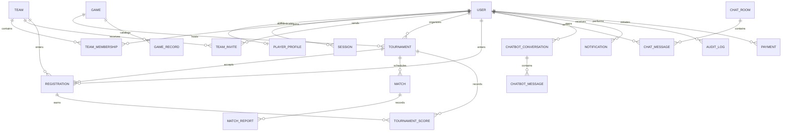

# ClutchVerse Architecture

## Product and implementation boundaries

ClutchVerse is an independent, mobile-first esports community for PUBG Mobile,
Free Fire, Tekken 8, and EA FC. The initial deployment is a pnpm/Turborepo
monorepo. The web application owns rendering, authenticated mutations, and
server-side authorization; a separately deployable Socket.IO service owns
presence and broadcast events. PostgreSQL is the source of truth. Redis is an
optional production accelerator for presence, sorted-set rankings, and
cross-instance event delivery. Local development uses explicit in-process
adapters when external credentials are absent.

External integrations (identity providers, email, payments, object storage, and
streaming) sit behind typed interfaces. Development adapters must remain
functional and visibly labeled; they must never report a real payment,
broadcast, or upload as completed when it was not. Game footage and publisher
logos are not bundled; hub backgrounds use original CSS/poster treatments until
the site owner supplies licensed media.

## Workspace layout

```text
apps/
  web/                 Next.js App Router, UI, server actions and API routes
  realtime/            Socket.IO service, Redis adapter and event validation
packages/
  db/                  Prisma schema, migrations, client and seed data
  ui/                  Shared design tokens and accessible UI primitives
  config/              Shared TypeScript, lint and formatting configuration
  core/                Domain models, validation, ranking, bracket and RBAC logic
```

The web app is deployable independently from `apps/realtime`. Shared domain
logic in `packages/core` is runtime-neutral. Secrets and service credentials
are server-only. Public configuration is prefixed `NEXT_PUBLIC_` and contains
no credentials.

## Data model / ERD



Core records: `User(id,email,passwordHash,role,locale,theme,createdAt)`;
`PlayerProfile(userId,handle,region,bio,avatarUrl,verifiedAt)`;
`Game(id,slug,name,accent,config)`;
`GameRecord(gameSlug,title,holder,value,achievedAt,proofUrl,verificationLabel)`;
`ContactMessage(name,email,topic,message,status,deliveryStatus,createdAt)`;
`Team(id,slug,name,gameSlug,createdAt)`;
`TeamInvite(teamId,inviterId,inviteeId,status,expiresAt)`;
`TeamMembership(teamId,userId,role,joinedAt)`;
`Tournament(id,gameId,organizerId,title,format,state,startsAt,region,prizePool,
entryFee,settings)`;
`Registration(id,tournamentId,userId?,teamId?,status,seed,checkedInAt)`;
`Match(id,tournamentId,round,position,state,startsAt,scoreA,scoreB,entrantAId,
entrantBId,winnerRegistrationId)`;
`MatchReport(id,matchId,reporterId,scoreA,scoreB,evidenceUrl,status,resolution)`;
`TournamentScore(tournamentId,registrationId,round,placement,eliminations,points)`;
`ChatRoom(id,slug,type,gameSlug?,teamId?)`;
`ChatMessage(id,roomId,authorId,body,replyToId,createdAt,deletedAt)`;
`ChatbotConversation(id,userId,title,createdAt,updatedAt)`;
`ChatbotMessage(id,conversationId,role,content,createdAt)`;
`Ranking(gameSlug,subjectId,subjectType,region,period,rating,points,updatedAt)`;
`Stream(ownerId,gameSlug,title,provider,providerUrl,state,scheduledAt)`;
`Notification(id,userId,type,payload,readAt,createdAt)`;
`Payment(id,userId,kind,amount,currency,provider,status,externalId)`;
`Report(id,reporterId,targetType,targetId,reason,evidence,status,reviewerId)`;
`AuditLog(id,actorId,action,targetType,targetId,metadata,createdAt)`.

IDs are opaque CUIDs. Money is stored as integer minor units with an ISO
currency code. Every state-changing operation is validated and authorized on
the server; audit-sensitive operations append an audit record in the same
transaction.

## Realtime contracts

Socket events use Zod-validated payloads. Authenticated sockets derive user identity and room permissions from the
verified token; guests may subscribe to public ranking rooms but cannot join
chat, send messages, type, or react. Clients cannot choose another user's
identity.

| Direction       | Event               | Payload                                    |
| --------------- | ------------------- | ------------------------------------------ |
| Client → server | `room:join`         | `{ roomId }`                               |
| Client → server | `room:leave`        | `{ roomId }`                               |
| Client → server | `chat:send`         | `{ roomId, body, replyToId? }`             |
| Client → server | `chat:typing`       | `{ roomId, active }`                       |
| Client → server | `ranking:subscribe` | `{ gameSlug, period, region? }`            |
| Server → client | `chat:message`      | Persisted message with author summary      |
| Server → client | `chat:typing`       | `{ roomId, userId, active }`               |
| Server → client | `presence:update`   | `{ userId, state, onlineCount }`           |
| Server → client | `ranking:update`    | `{ gameSlug, period, entries, updatedAt }` |
| Server → client | `tournament:update` | `{ tournamentId, state, changedAt }`       |

When Redis is configured, ranking events are relayed through Redis pub/sub and
the Socket.IO Redis adapter distributes events across realtime instances.
Without Redis, socket delivery and presence accounting are local to one
process. Chat history is always persisted and fetched over HTTP; socket
delivery is not the source of truth.

## HTTP API surface

All mutation inputs and query parameters are Zod-validated. Protected routes
perform server-side RBAC checks and return stable JSON error shapes.

| Method and route                           | Purpose                                                       |
| ------------------------------------------ | ------------------------------------------------------------- |
| `GET /api/games`                           | Game catalog and public hub data                              |
| `GET /api/tournaments`                     | Filter and page tournaments                                   |
| `POST /api/tournaments`                    | Organizer creates a tournament                                |
| `POST /api/tournaments/:id/register`       | Register player or team                                       |
| `POST /api/tournaments/:id/check-in`       | Check in an eligible entry                                    |
| `GET /api/tournaments/:id/bracket`         | Bracket and match states                                      |
| `POST /api/matches/:id/report`             | Submit a match result or dispute                              |
| `GET /api/rankings/:game`                  | Ranked players/teams by period and region                     |
| `POST /api/rankings/scores`                | Organizer submits battle-royale round results                 |
| `GET /api/chat/:roomId/messages`           | Cursor-paginated message history                              |
| `POST /api/chat/:roomId/messages`          | Send a moderated chat message                                 |
| `GET/POST /api/chat`                       | List conversations or stream an authenticated AI reply        |
| `GET/DELETE /api/chat/conversations/:id`   | Read or delete the current user's AI conversation             |
| `GET /api/streams`                         | Live, scheduled, and archived broadcasts                      |
| `GET /api/teams/:slug`                     | Team roster, profile, and results                             |
| `GET /api/players/:handle`                 | Player profile and ranking history                            |
| `GET /api/notifications`                   | Current user's notifications                                  |
| `POST /api/reports`                        | Report a player, match, or content                            |
| `GET /api/admin/analytics`                 | Admin-only aggregate metrics                                  |
| `POST /api/contact`                        | Rate-limited contact submission and email notification        |
| `GET/POST /api/admin/game-records`         | Admin-only community record listing and creation              |
| `PATCH/DELETE /api/admin/game-records/:id` | Admin-only community record editing and deletion              |
| `GET/PATCH /api/profile/preferences`       | Read/update a signed-in user's locale and appearance settings |

Static localization catalogs are maintained under
`apps/web/src/i18n/messages/` for English, Urdu, Arabic, Simplified Chinese,
Hindi, and Spanish. The locale is stored in a browser cookie/local storage and
the signed-in profile. Urdu and Arabic use RTL document direction. Navigation,
footer, FAQ, and AI chat messages are localized; translation coverage for all
other page/game-specific content remains in progress.

Auth.js handles credentials and optional Google/Discord providers. Credentials
are password-hashed; roles are `user`, `player`, `team_captain`, `organizer`,
`moderator`, and `admin`. The application must not trust role claims supplied
by the browser.

The optional ClutchVerse AI widget requires an authenticated user. Its route
limits requests per user, keeps at most ten prior turns in each Gemini prompt,
redacts common email/phone patterns, applies a local gaming-topic scope check,
and streams Gemini text from the server. Gemini receives only sanitized chat
content and curated public game rules, FAQs, and tournament summaries; it never
receives account/profile data. Conversation records are user-owned and cascade
on account deletion. `GEMINI_API_KEY` is server-only; `GEMINI_MODEL` defaults
to `gemini-flash-latest`.

## Theme and accessibility tokens

The theme provider persists a selected theme and performance preferences in
local storage and, for signed-in accounts, the user profile. The server renders
a safe default theme to prevent a flash of unstyled content. Game accents are
an optional override and do not replace the user's selected base theme.

| Theme        | Primary   | Accent    | Background |
| ------------ | --------- | --------- | ---------- |
| Neon Cyber   | `#9d4edd` | `#00f5d4` | `#090a12`  |
| Crimson War  | `#c1121f` | `#ff6b35` | `#10080b`  |
| Toxic Venom  | `#84cc16` | `#00e676` | `#080f0a`  |
| Arctic Frost | `#38bdf8` | `#a5f3fc` | `#07111b`  |
| Royal Gold   | `#d4a72c` | `#f5d76e` | `#100e08`  |
| Light Pro    | `#4f46e5` | `#0891b2` | `#f4f6fb`  |

Game accent overrides: PUBG tactical amber/olive, Free Fire flame orange,
Tekken fighter red/purple, and EA FC electric green/blue. All foreground and
surface combinations require AA contrast. Animations honor
`prefers-reduced-motion`, stop while the tab is hidden, and can be disabled via
performance mode.

## Operational decisions

- PostgreSQL/Prisma is authoritative; Redis is optional for local startup.
- Public game records are community-verified contributions, never publisher
  records; admins manage them through authenticated, audited CRUD routes.
- Contact messages are persisted before notification. Resend is used when
  configured; otherwise delivery is explicitly marked as a development mock.
- External providers are adapters, with an explicit development implementation.
- No copyrighted game footage, publisher marks, or logos ship with the project.
- Schedule timestamps are UTC and displayed in the user's locale/time zone.
- Payments, prize withdrawals, and identity-provider callbacks are disabled
  unless a real provider is configured; development mode cannot move money.
- Security headers, same-origin mutation protection, rate limits, file type and
  size limits, and authorization checks apply at the server boundary.
